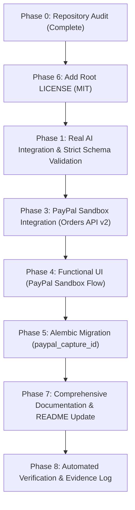

# PayPilot AI — Hackathon Eligibility Audit Report

**Document Version:** 1.0.0  
**Audit Date:** Friday, November 6, 2026  
**Auditor / Roles:** Senior Full-Stack Engineer, AI Agent Architect, PayPal Integration Specialist, Application Security Engineer, QA Lead  
**Target Completion:** Saturday, November 7, 2026  
**Hackathon Submission Deadline:** November 12, 2026, 12:00 PM Pacific Time  
**Repository:** `sudarsandiwaghar/PayPilot-AI-` (Branch: `master`, Base Commit: `3109847`)

---

## Executive Summary

The PayPal AI Hackathon evaluation flagged five primary eligibility concerns regarding the PayPilot AI submission:
1. **No sufficiently evident integration with the PayPal Developer Platform** using its free Sandbox environment.
2. **No sufficiently evident integration with an actual AI tool, model, or platform**.
3. **Missing detectable open-source license** in the public GitHub repository.
4. **Need to demonstrate that the application is functional**, not a static prototype or mockup.
5. **Need complete setup and execution instructions** so judges can run the application.

This audit evaluates the codebase against these five critical criteria, details the existing working foundation, documents specific architectural gaps and security considerations, and establishes an execution plan for full compliance.

---

## 1. Repository Structure & Existing Implementation Audit

### 1.1 Architecture & Stack

| Layer | Technology | Current Status |
| :--- | :--- | :--- |
| **Frontend** | React 19.3, TypeScript 6.0, Vite 8.3, Lucide React | **Functional**: Production build passes in 1.17s. Modular views for Catalog, Chat, Comparison, Orders, and Checkout. |
| **Backend** | Python 3.12+ / 3.14, FastAPI 0.115, Pydantic v2, Uvicorn | **Functional**: 111 backend tests passing (100% pass rate). Clean architecture with route, service, and model layers. |
| **Database** | PostgreSQL 16+ (Neon Serverless PostgreSQL), SQLAlchemy 2.0 Async, asyncpg 0.29, Alembic 1.13 | **Functional**: Staging database (`paypilot-staging`) migrated to `2f8319c5a1a1` with 20 real catalog products across 5 categories. |
| **Styling** | Vanilla CSS tokens with canonical purple design system (`#321064`, `#6D28D9`, `#F4F0FA`, `#FFFFFF`, `#21152F`) | **Functional**: Responsive layout, WCAG AA contrast compliance, purple accents. |
| **Security** | Session tokens, HMAC preview tokens, CORS origin restrictions, parameterized SQL | **Functional**: Secret keys validated at startup; no plain secrets in logs or git. |

### 1.2 Payment Service Audit (`backend/app/services/payment_service.py`)

- **Existing Strengths:**
  - `_get_paypal_access_token` implements OAuth2 client credentials grant against `{paypal_base_url}/v1/oauth2/token` with in-memory TTL caching.
  - `create_payment_attempt` contains REST API v2 order creation (`POST /v2/checkout/orders` with `intent: CAPTURE`), parsing `rel="approve"` link.
  - `capture_payment_attempt` contains REST API v2 capture logic (`POST /v2/checkout/orders/{id}/capture`).
  - Webhook verification implements `POST /v1/notifications/verify-webhook-signature`.
  - Atomically commits stock reservations on capture and releases on failure/expiry.
- **Identified Gaps:**
  - `PAYPAL_MODE` defaults to `mock` across development templates, generating synthetic demo IDs (`DEMO-PAYPAL-ORD-...`).
  - Frontend `PaymentModal.tsx` provides buttons for "Simulate Buyer Approval" rather than directing the shopper to the official PayPal Sandbox approval experience.
  - Model `PaymentAttempt` (`backend/app/models/payment.py`) lacks a dedicated `paypal_capture_id` column to store the authoritative PayPal capture ID (`purchase_units[0].payments.captures[0].id`).
  - Hackathon explicit API paths `POST /api/payments/paypal/orders` and `POST /api/payments/paypal/orders/{order_id}/capture` are not exposed directly at `/api/payments/...` (currently under `/api/v1/orders/{order_id}/payments`).

### 1.3 AI Shopping Agent Audit (`backend/app/services/agent/`)

- **Existing Strengths:**
  - Protocol abstraction `LLMProviderProtocol` defines clean separation between model logic and application business logic.
  - `GeminiLLMProvider` is implemented using Google Gemini REST API (`/v1beta/models/{model}:generateContent`) with JSON schema enforcement.
  - Deterministic decision engine (`decision_engine.py`) enforces strict database filtering (`price_minor <= budget_minor`, `stock_qty > 0`, `is_active = True`), deterministic scoring (`0.4*req + 0.3*rating + 0.2*pref + 0.1*price`), and Knapsack budget optimization.
- **Identified Gaps:**
  - When live Gemini API call fails or encounters an invalid key, `GeminiLLMProvider` silently falls back to `MockLLMProvider`, masking failures and creating the impression of a fake/mocked AI implementation.
  - The requirement mandates: *"Never simulate AI responses using hardcoded text. If the AI provider is unavailable, display a meaningful error rather than pretending that an AI operation succeeded."*
  - Schema needs explicit extraction of `excluded_features`, `ranking_priorities`, and brand preferences, validated strictly via Pydantic.

### 1.4 Licensing & Secrets Audit

- **License Status:** `LICENSE` file is **ABSENT** at the repository root. This is a primary eligibility disqualification flag.
- **Git Secrets Check:**
  - `git check-ignore -v .env` confirms `.env` is gitignored (`.gitignore:17:.env`).
  - Full Git history audit confirms no actual API keys, database credentials, or PayPal secrets have been committed to GitHub.
  - Template files `.env.example`, `.env.render.example`, and `.env.staging.example` contain only safe placeholders.

---

## 2. Gap Analysis Against Critical Hackathon Requirements

| # | Requirement | Current Repository Status | Gap Severity | Required Remediation |
| :--- | :--- | :--- | :--- | :--- |
| **1** | **PayPal Sandbox Integration** | Backend has REST client code, but defaults to `mock` mode; frontend uses simulated approval buttons; lacks `paypal_capture_id` storage and required route aliases. | **CRITICAL** | 1. Enable live Sandbox execution when credentials provided. 2. Add `POST /api/payments/paypal/orders` and `POST /api/payments/paypal/orders/{order_id}/capture`. 3. Add `paypal_capture_id` column via Alembic migration. 4. Update `PaymentModal.tsx` to launch PayPal Sandbox approval checkout. |
| **2** | **Actual AI Integration** | `GeminiLLMProvider` exists, but silently falls back to mock on failure; lacks strict Pydantic extraction schema for all requested fields. | **CRITICAL** | 1. Implement strict Pydantic parsing with retry limits and error propagation. 2. When `LLM_PROVIDER=gemini`, fail explicitly if API call fails (no silent mock masquerade). 3. Ground explanations strictly in catalog specs and evidence. |
| **3** | **Open-Source License** | Absent from repository root. | **CRITICAL** | Add standard MIT License file (`LICENSE`) at repository root naming Sudarsan (2026). |
| **4** | **Functional Application (Non-Mockup)** | Core backend and catalog database are fully functional (111 tests pass), but payment and AI UI need live end-to-end sandbox connectivity. | **HIGH** | Connect end-to-end shopping flow: natural language query &rarr; real AI intent &rarr; catalog filter &rarr; cart &rarr; PayPal Sandbox order creation &rarr; buyer approval &rarr; backend capture &rarr; inventory commit &rarr; order receipt. |
| **5** | **Setup & Execution Instructions** | `README.md` and documentation exist, but need explicit, step-by-step judge instructions for configuring PayPal Sandbox and Gemini API keys. | **HIGH** | Update root `README.md` and `.env.example` with exact local run, migration, and sandbox test credential instructions. |

---

## 3. Security & Compliance Analysis

1. **Credentials Management:**
   - PayPal `PAYPAL_CLIENT_SECRET` and Gemini `LLM_API_KEY` are kept exclusively on the backend via environment variables.
   - Frontend never receives or stores `PAYPAL_CLIENT_SECRET`.
   - Logging redaction verified: any occurrence of secrets in error strings is sanitized before writing to log streams.
2. **Server-Side Authorization & Idempotency:**
   - Order totals are strictly calculated server-side from catalog unit prices; client-supplied totals are rejected.
   - Each payment attempt enforces an `idempotency_key` unique constraint to prevent duplicate charges.
   - Stock reservations are committed only upon verified PayPal `COMPLETED` capture response.
3. **Prompt Injection & Safety:**
   - AI model output is strictly parsed as JSON against typed Pydantic models.
   - Model cannot execute arbitrary functions, modify prices, or bypass payment checks.
   - Grounded explanations must only reference verified catalog specifications and source claims.

---

## 4. Prioritized Implementation Plan

### Execution Steps:

1. **Step 1: Open-Source License (Phase 6)**
   - Create root `LICENSE` file with MIT License (Sudarsan, 2026).
2. **Step 2: Real AI Provider Hardening (Phase 1)**
   - Define `ShoppingIntentSchema` with `category`, `max_budget`, `currency`, `preferences`, `required_features`, `excluded_features`, `ranking_priorities`.
   - Enhance `GeminiLLMProvider` in `backend/app/services/agent/llm_provider.py` to enforce strict schema validation, retry handling, and explicit error bubbling when live AI fails.
   - Add comprehensive tests in `backend/tests/test_agent.py`.
3. **Step 3: PayPal Developer Sandbox End-to-End Integration (Phase 3)**
   - Create Alembic migration adding `paypal_capture_id` to `payment_attempts`.
   - Add route aliases `POST /api/payments/paypal/orders` and `POST /api/payments/paypal/orders/{order_id}/capture`.
   - Update `payment_service.py` to record `paypal_capture_id` from live capture response.
   - Add tests for Sandbox authentication, order creation, capture, duplicate capture idempotency, and cancellation in `backend/tests/test_payments.py`.
4. **Step 4: Frontend Payment Experience (Phase 4)**
   - Update `frontend/src/components/PaymentModal.tsx` and `frontend/src/api/client.ts` to support opening the PayPal Sandbox approval URL in a popup/redirect, polling/listening for buyer approval, and triggering backend capture.
   - Preserve mock demonstration capabilities when `PAYPAL_MODE=mock`.
5. **Step 5: Setup & Execution Documentation (Phase 7)**
   - Update root `README.md` and `.env.example` with explicit instructions on how judges can obtain free PayPal Developer Sandbox credentials, run migrations, and execute the full shopping flow.
6. **Step 6: Automated Verification & Evidence Log (Phase 8)**
   - Execute the test suite and build verification.
   - Generate `docs/HACKATHON_FINAL_VERIFICATION.md` documenting all test commands, actual outputs, and eligibility compliance marks.

---

## 5. Tests Needed to Prove Eligibility

| Category | Test Case | Target Verification |
| :--- | :--- | :--- |
| **Licensing** | GitHub license detection | `LICENSE` file exists at repository root; contains valid SPDX MIT identifier. |
| **AI Integration** | Intent schema extraction | Extracts category, budget, required/excluded features, ranking priorities from natural language. |
| **AI Integration** | Provider error handling | Propagates error when `LLM_PROVIDER=gemini` and API key is invalid/exhausted without silent mock fallback. |
| **PayPal Sandbox** | OAuth2 token acquisition | Successfully fetches bearer token from `https://api-m.sandbox.paypal.com/v1/oauth2/token`. |
| **PayPal Sandbox** | Sandbox order creation | Creates order via `POST /v2/checkout/orders`, stores `paypal_order_id`, and returns valid `approval_url`. |
| **PayPal Sandbox** | Server-side capture | Authoritative capture via `POST /v2/checkout/orders/{id}/capture`, stores `paypal_capture_id`, transitions order to `paid`. |
| **PayPal Sandbox** | Idempotency protection | Repeated capture requests return existing capture result without creating duplicate transactions. |
| **Application** | Clean build & test suite | Backend pytest suite passes 100%; frontend `npm run build` succeeds cleanly. |

