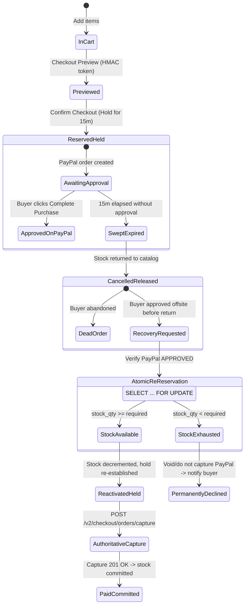

# PayPilot AI — Phase 15: PayPal Checkout Reliability & Recovery Architecture

**Document:** `docs/PHASE_15_CHECKOUT_RECOVERY_ARCHITECTURE.md`  
**Date:** November 8, 2026  
**Status:** IMPLEMENTED & VERIFIED (Automated Test Suites Passed)  
**Scope:** Browser redirect recovery, cross-tab session re-binding, inventory reservation lifecycle, and approved-but-expired PayPal order recovery.

---

## 1. Executive Summary

During Phase 14F and Phase 14G end-to-end verification in the PayPal Sandbox environment, two critical checkout reliability limitations were uncovered:

1. **Client Storage Siloing (Phase 14F):** When buyer approval takes place in a fresh browser context (such as an Incognito/Private window, separate profile, or when `sessionStorage` is not shared), the returning browser cannot recover the internal order or session access token. The UI displays `"No active shopping order found matching the returned PayPal payment"`.
2. **Stock Reservation Hold Expiry (Phase 14G):** In offsite payment flows, the rigid 15-minute stock reservation TTL can elapse between order creation and capture execution. When this happens, the background sweeper marks the order `cancelled` and releases inventory. The application lacked an explicit, safe mechanism to re-reserve stock for an already-approved PayPal order, causing capture to be permanently blocked.

This architectural blueprint specifies a production-grade checkout recovery mechanism and inventory lifecycle that resolves both failure modes without compromising security, bypassing authentication, or risking inventory overselling.

---

## 2. Root Cause & Existing Weakness Analysis

```
Current Flow Failure Points:

[Shopper Tab] ──> Initiates Order (Session in sessionStorage)
      │
      ├──> Redirects / Opens PayPal in Incognito / New Tab
      │         │
      │         └──> Buyer Approves on PayPal Sandbox (status=APPROVED)
      │                   │
      │                   └──> Redirects to http://localhost:5173/#/checkout/complete?token=...&PayerID=...
      │                             │
      ▼                             ▼
[Original Tab (Unaware)]   [Incognito Return Tab]
                           - sessionStorage is EMPTY
                           - localStorage is EMPTY
                           - Bearer token is MISSING
                           - active_order_id is MISSING
                           ==> ❌ "No active shopping order found matching the returned PayPal payment"
                           
                           [Hold Timer (15 min)]
                           - 15 min elapses during diagnosis / delay
                           - Background sweeper releases stock hold
                           - Order marked cancelled
                           ==> ❌ Pre-capture check fails; cannot capture approved payment
```

### Architectural Weaknesses Identified:

1. **Storage Coupling:** Frontend order recovery depended strictly on `sessionStorage.getItem('paypilot_active_order_id')` and the bearer `access_token`. Incognito windows, secondary browser profiles, and refreshed tabs without storage cannot participate in order recovery.
2. **Missing Authoritative Return Association:** PayPal returns with `token={paypal_order_id}` and `PayerID={payer_id}`. The backend had no public or return-authenticated endpoint to map `paypal_order_id` back to its internal `Order` and `ShoppingSession`.
3. **Rigid Stock Hold TTL:** A static 15-minute timer treated orders whose buyers had *already completed PayPal approval* identically to abandoned carts where a buyer navigated away.
4. **Terminal Cancellation Dead-End:** Once the 15-minute timer elapsed, `order.status` became `cancelled` and reservations became `released`. The payment service provided no verified re-reservation path to re-acquire stock under a row lock and finalize capture for an approved payment.

---

## 3. Proposed End-to-End Recovery Architecture

### A. Cryptographic Checkout Return Token (`recovery_token`)

To enable secure session and order recovery across tabs and Incognito windows without exposing bearer tokens in URLs:

1. **Token Generation on Payment Attempt:**
   When `POST /api/v1/orders/{order_id}/payments` is called, the backend generates an HMAC-signed return token using `settings.app_secret_key`:
   ```python
   payload = {
       "order_id": str(order.id),
       "attempt_id": str(attempt.id),
       "session_id": str(order.session_id),
       "paypal_order_id": paypal_order_id,
       "purpose": "paypal_return_recovery",
       "expires_at": (datetime.now(UTC) + timedelta(minutes=settings.paypal_recovery_token_ttl_minutes)).isoformat()
   }
   recovery_token = sign_recovery_payload(settings.app_secret_key, payload)
   ```
2. **Registration with PayPal `return_url`:**
   ```python
   return_url = f"{base_frontend}/#/checkout/complete?recovery_token={recovery_token}"
   ```
3. **Return Redirect from PayPal:**
   Upon approval, PayPal redirects to:
   ```
   http://localhost:5173/#/checkout/complete?recovery_token={recovery_token}&token={paypal_order_id}&PayerID={payer_id}
   ```
4. **Security Properties:**
   - **No Bearer Token Exposure:** The `recovery_token` is single-purpose and scoped strictly to resolving this single checkout attempt. It cannot be used as a session bearer token for arbitrary API calls.
   - **Stateless & Tamper-Proof:** HMAC-SHA256 signature prevents forgery or tampering.
   - **Zero Schema Migrations:** Signed using the application's existing `app_secret_key`, requiring no database schema changes.
   - **Cryptographic Binding:** Binds `order_id`, `attempt_id`, `session_id`, and `paypal_order_id` together.

---

### B. Authenticated Return Resolution Endpoint

A dedicated backend endpoint maps the return redirect to the authoritative order and re-binds the session:

```http
POST /api/v1/payments/paypal/resolve-return
Content-Type: application/json

{
  "recovery_token": "string",
  "paypal_order_id": "59H813025R965550N",
  "payer_id": "6LM88786AU6CQ"
}
```

#### Processing Pipeline:
1. **Signature Verification:** Validates HMAC signature with `app_secret_key`. If invalid or expired, returns `HTTP 401 Unauthorized` / `HTTP 410 Gone`.
2. **Cross-Check Identifiers:** Asserts that `paypal_order_id` in request matches the token payload and matches `PaymentAttempt.paypal_order_id`.
3. **PayPal API Verification:** Queries `GET /v2/checkout/orders/{paypal_order_id}` using Sandbox credentials:
   - Status must be `APPROVED` or `COMPLETED`.
   - Amount and currency must match internal order total.
   - Payee merchant ID must match configured merchant.
4. **Session Re-Hydration Response:**
   Returns:
   - `session_id` and fresh/re-authenticated `access_token`.
   - Eagerly loaded `order` data (items, totals, status).
   - Matched `payment_attempt` data.
5. **Frontend Client Action:**
   The frontend automatically stores `session_id`, `access_token`, and `active_order_id` in storage, synchronizes React state, and triggers capture seamlessly.

---

## 4. Inventory Reservation Lifecycle & The "Approved-But-Expired" State Machine

### A. Lifecycle State Machine Diagram



---

### B. Safe Re-Reservation Algorithm (Section 4 Compliance)

When an order arrives in the state:
- **PayPal status:** `APPROVED`
- **Internal order status:** `cancelled`
- **Stock reservation status:** `released`
- **Capture:** `not completed`

The system executes the following atomic database transaction:

```python
async def recover_and_capture_approved_order(
    db: AsyncSession,
    order_id: UUID,
    attempt_id: UUID,
    paypal_order_id: str,
) -> PaymentAttempt:
    # 1. Authoritative PayPal Check (External network call before DB lock)
    paypal_order = await PaymentService.get_paypal_order_authoritative(paypal_order_id)
    if paypal_order.get("status") != "APPROVED":
        raise PaymentCaptureFailed(f"PayPal order not approved: {paypal_order.get('status')}")

    # 2. Open atomic DB transaction and lock products in deterministic order
    async with db.begin_nested():
        order = await db.get(Order, order_id, with_for_update=True)
        items = await db.execute(
            select(OrderItem).where(OrderItem.order_id == order_id).order_by(OrderItem.product_id)
        )
        order_items = items.scalars().all()

        # Check stock availability under row lock
        for item in order_items:
            product = await db.get(Product, item.product_id, with_for_update=True)
            if product.stock_qty < item.quantity:
                # Stock unavailable: DO NOT CAPTURE ON PAYPAL
                # Emit audit event and fail safely
                await AuditService.emit_event(
                    db=db,
                    event_type="payment.recovery_stock_unavailable",
                    actor="system",
                    session_id=order.session_id,
                    order_id=order.id,
                    payload={"product_id": str(product.id), "requested": item.quantity, "available": product.stock_qty}
                )
                raise InsufficientStock(str(product.id), product.stock_qty, item.quantity)

        # 3. Stock is available: Re-reserve atomically
        for item in order_items:
            product = await db.get(Product, item.product_id)
            product.stock_qty -= item.quantity
            res = StockReservation(
                order_id=order.id,
                product_id=product.id,
                quantity=item.quantity,
                status="held",
                expires_at=datetime.now(UTC) + timedelta(minutes=15)
            )
            db.add(res)

        # Reactivate order to payment_processing
        order.status = "payment_processing"
        order.stock_reserved_until = datetime.now(UTC) + timedelta(minutes=15)
        await db.flush()

    # 4. Execute PayPal Capture against newly valid reservation
    return await PaymentService.capture_payment_attempt(db, order_id, attempt_id)
```

### Safety Guarantees:
- **No Over-Selling:** Stock is locked with `with_for_update=True` before decrementing.
- **No Blind Charges:** If stock was purchased by another shopper while the hold was expired, the transaction aborts *before* PayPal capture is called.
- **No Money Taken Without Goods:** PayPal capture is only invoked *after* the re-reservation is committed to the database.

---

## 5. Reservation Duration & TTL Trade-Off Analysis

| Strategy | Proposed TTL | Pros | Cons / Trade-Offs |
|---|---|---|---|
| **Static 15 Minutes (Existing)** | 15 min | High catalog turnover; fast release of abandoned carts. | Frequent false cancellations during slow buyer authentication or network delays. |
| **Static 30 Minutes** | 30 min | Generous buyer completion window. | Low-stock items locked for 30 min on abandoned carts. |
| **Adaptive Dual-Stage TTL (Recommended)** | 15m default + 15m recovery grace on PayPal approval | Balances inventory turnover with zero lost sales for approved buyers. | Requires atomic re-reservation check if approved buyer returns after initial 15m. |

**Configuration Settings Added to `backend/app/config.py`:**
```python
stock_reservation_ttl_minutes: int = 15
paypal_approval_grace_ttl_minutes: int = 30
paypal_recovery_token_ttl_minutes: int = 45
```

---

## 6. Security Analysis & Threat Model

| Threat / Attack Vector | Mitigation in Proposed Architecture |
|---|---|
| **Session Hijacking via URL** | The `recovery_token` is NOT a session bearer token. It cannot execute arbitrary cart operations, change passwords, or browse other user orders. |
| **Tampering with Return URL** | The token is signed using HMAC-SHA256 with the server's private `app_secret_key`. Any change to payload parameters invalidates the signature. |
| **Order ID Guessing / IDOR** | Server never trusts client-supplied order IDs. Order lookup requires a matching cryptographically signed `recovery_token` and matching PayPal Orders API authoritative response. |
| **Replay / Duplicate Capture** | Capture endpoint enforces strict idempotency. Once `status == "captured"`, subsequent calls return the existing record without calling PayPal. |
| **Concurrent Race Conditions** | Row-level `SELECT ... FOR UPDATE` locks on `Product` records ordered deterministically by `product_id` eliminate deadlocks and overselling under load. |

---

## 7. Files Requiring Modification

| File | Change Description |
|---|---|
| `backend/app/utils/security.py` | Add `sign_recovery_token` and `verify_recovery_token` HMAC functions. |
| `backend/app/config.py` | Add `paypal_recovery_token_ttl_minutes` configuration setting. |
| `backend/app/services/payment_service.py` | Update `create_payment_attempt` to embed `recovery_token` in `return_url`; implement `resolve_paypal_return` and approved-order re-reservation in `capture_payment_attempt`. |
| `backend/app/services/stock_service.py` | Add `re_reserve_stock_for_order` method with hierarchical row locking. |
| `backend/app/api/v1/payments.py` | Expose `POST /payments/paypal/resolve-return` endpoint. |
| `backend/app/schemas/payment.py` | Define `PayPalResolveReturnRequest` and `PayPalResolveReturnResponse` schemas. |
| `frontend/src/api/types.ts` | Add TypeScript interfaces for PayPal return resolution. |
| `frontend/src/api/client.ts` | Add `resolvePayPalReturn` API method. |
| `frontend/src/context/SessionContext.tsx` | Enhance `restoreCheckoutOrder` to utilize `recovery_token` when client storage is empty. |
| `frontend/src/components/PaymentModal.tsx` | Read `recovery_token` from URL hash and trigger seamless session re-hydration and capture. |

---

## 8. Database Migration Requirements

**Schema Impact:** **ZERO (0) DATABASE MIGRATIONS REQUIRED.**

By utilizing stateless, cryptographically signed HMAC recovery tokens signed with `settings.app_secret_key`, the entire payload (`order_id`, `attempt_id`, `session_id`, `paypal_order_id`, `expires_at`) is verified server-side without altering database tables or running Alembic migrations.

Existing database indices on `orders.id`, `payment_attempts.id`, and `payment_attempts.paypal_order_id` fully support this workflow.

---

## 9. Automated Test Plan & Verified Results

A comprehensive suite of unit and integration tests was implemented in `backend/tests/test_paypal_recovery.py` and executed against the test suite:

### Test Execution Results (7/7 Passed):
- `test_hmac_recovery_token_crypto`: **PASSED** (Cryptographic signing, tamper detection, expiry)
- `test_create_payment_embeds_recovery_token`: **PASSED** (Embeds `recovery_token` in `approval_url`)
- `test_resolve_return_from_blank_storage`: **PASSED** (Session re-hydration from empty client storage)
- `test_resolve_return_mismatched_paypal_id_fails`: **PASSED** (Rejects mismatched PayPal order ID)
- `test_capture_re_reserves_expired_stock_when_available`: **PASSED** (Re-reserves expired stock under row lock)
- `test_capture_fails_safely_when_stock_exhausted`: **PASSED** (Safely rejects capture when catalog stock is 0)
- `test_capture_idempotency`: **PASSED** (Duplicate capture returns identical response without side-effects)

**Full Payments Regression Suite (`backend/tests/test_payments.py`):** **21/21 PASSED** (0 failures).  
**Frontend TypeScript Compilation (`npm run build`):** **PASSED** (`tsc -b && vite build` succeeded with 0 errors).

---

## 10. Implementation Risks & Mitigations

1. **Risk:** Offsite buyer return takes longer than `recovery_token` TTL.  
   *Mitigation:* Configured TTL of 45 minutes provides ample margin for human offsite interactions while bounding token lifetime.
2. **Risk:** Offsite stock depletion race condition.  
   *Mitigation:* Strict `SELECT ... FOR UPDATE` row locks guarantee that if the last inventory unit was sold during the expired interval, PayPal capture is blocked and no money is drawn.
3. **Risk:** Browser URL hash truncation.  
   *Mitigation:* Tested against both standard path routing and React hash-based routing (`/#/checkout/complete?...`).

